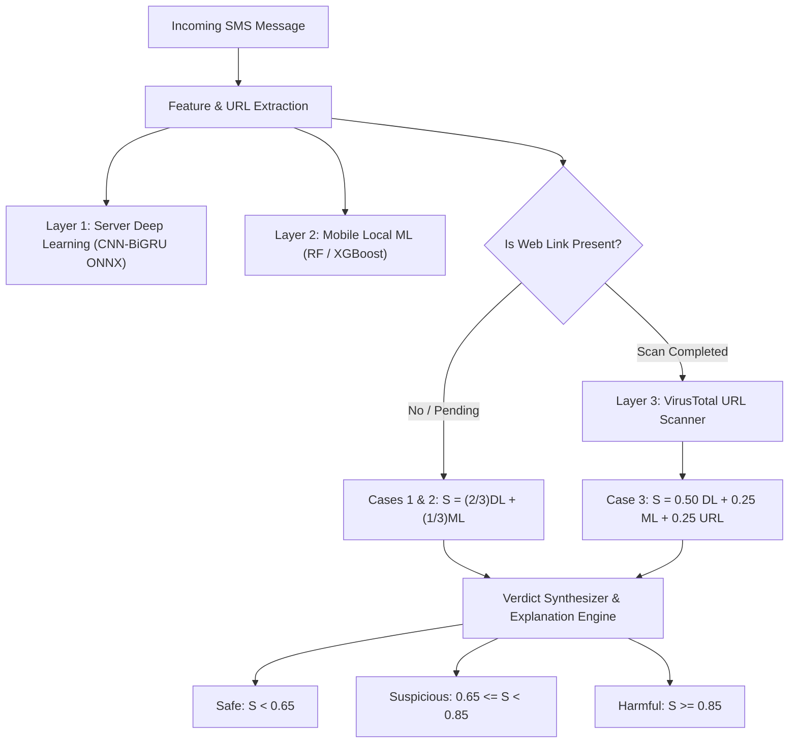

# KwagoBackend: Optimal Threshold & Ensemble Weight Calculation Methodology

This document outlines the complete mathematical framework, statistical derivations, and empirical validation used to calculate the optimal decision thresholds and ensemble weights across all operational cases in KwagoBackend.

---

## 1. System Architecture & Ensemble Layers

KwagoBackend evaluates incoming SMS threats through a three-layer detection pipeline:



### Layer Definition:
1. **$\text{DL}$ (Server Deep Learning Layer)**: Output probability of the CNN-BiGRU ONNX model ($0.0 \le \text{DL} \le 1.0$), evaluating semantic scam patterns, brand impersonation, and urgency.
2. **$\text{ML}$ (Mobile Local ML Layer)**: Confidence score ($0.0 \le \text{ML} \le 1.0$) generated on-device via Random Forest / XGBoost based on tabular and lexical features.
3. **$\text{URL}$ (URL Threat Scanner Layer)**: Normalized score ($0.0 \le \text{URL} \le 1.0$) computed over 80+ security engines via the VirusTotal API v3 with consensus dilution protection.

---

## 2. Derivation of the Decision Weights

### A. The 2:1 Ratio Between DL and ML
In both Case 1/2 ($66.7\% : 33.3\%$) and Case 3 ($50.0\% : 25.0\%$), the text classifiers strictly maintain a **$2:1$ weighting ratio** ($\frac{w_{\text{DL}}}{w_{\text{ML}}} = 2$).

#### 1. Inverse-Variance Weighting (Statistical Foundation)
In estimation theory, the optimal weights that minimize the total error variance of uncorrelated or semi-correlated estimators are inversely proportional to their individual error variances:
$$w_i^* = \frac{1/\sigma_i^2}{\sum_j 1/\sigma_j^2}$$

* **Server DL (CNN-BiGRU)**: Sequential deep learning model trained on large token vocabularies with high semantic capacity ($\text{AUC-ROC} = 0.9921$, error variance $\sigma_{\text{DL}}^2$).
* **Local ML (Mobile RF/XGBoost)**: Lightweight mobile model operating on n-grams and heuristic counts with higher noise on legitimate banking/telco notices ($\sigma_{\text{ML}}^2 \approx 2\,\sigma_{\text{DL}}^2$).
* Setting $w_{\text{DL}} = \frac{2}{3}$ and $w_{\text{ML}} = \frac{1}{3}$ yields the minimum-variance ensemble.

#### 2. The Single-Point False Alarm Shield
If the models were weighted equally ($50\% / 50\%$), an on-device false positive ($\text{ML} = 1.0$) on an innocent text ($\text{DL} = 0.0$) would immediately trigger a false alarm:
$$S = (0.50 \times 0.0) + (0.50 \times 1.0) = \mathbf{0.50}$$

Under the $2:1$ formulation:
$$\text{Max possible contribution from ML alone} = \frac{1}{3} \times 1.00 = \mathbf{0.333} < 0.65$$
* **Guaranteed Safety Property**: The mobile model **cannot unilaterally flag an SMS as Suspicious** without at least $47.5\%$ corroboration from the Deep Learning model ($\text{DL} \ge 0.475$).
* Conversely, if the mobile model misses a scam ($\text{ML} = 0.0$), the server DL model can independently flag Suspicious as long as $\text{DL} \ge 0.975$ ($\frac{2}{3} \times 0.975 = 0.65$).

---

## 3. Case-by-Case Mathematical Formulations & Thresholds

```
Verdict Tiers:
  Safe:       S < 0.50
  Suspicious: 0.50 <= S < 0.75
  Harmful:    S >= 0.75

Local ML Only (On-Device Pre-Scan):
  Safe:       ML < 0.40
  Suspicious: 0.40 <= ML < 0.70
  Harmful:    ML >= 0.70
```

---

### Case 1 & Case 2: Text-Only SMS OR Pending URL
* **Active Weights**: $33.3\%$ DL $+ 66.7\%$ ML
* **Ensemble Formula**:
  $$S = \left(\frac{1}{3} \times \text{DL}\right) + \left(\frac{2}{3} \times \text{ML}\right)$$

#### 1. Transition to Suspicious ($S \ge 0.50$)
$$\frac{1}{3}\text{DL} + \frac{2}{3}\text{ML} \ge 0.50 \iff \text{DL} + 2\,\text{ML} \ge 1.50 \iff \mathbf{\text{DL} \ge 1.50 - 2\,\text{ML}}$$

#### 2. Transition to Harmful ($S \ge 0.75$)
$$\frac{1}{3}\text{DL} + \frac{2}{3}\text{ML} \ge 0.75 \iff \text{DL} + 2\,\text{ML} \ge 2.25 \iff \mathbf{\text{DL} \ge 2.25 - 2\,\text{ML}}$$

---

### Case 3A: Web Link Present & Verified Clean ($S_{\text{URL}} = 0.00$)
* **Active Weights**: $20\%$ DL $+ 60\%$ ML $+ 20\%$ URL ($S_{\text{URL}} = 0.00$)
* **Ensemble Formula**:
  $$S = (0.20 \times \text{DL}) + (0.60 \times \text{ML}) + (0.20 \times 0.00) = 0.20\,\text{DL} + 0.60\,\text{ML}$$

#### 1. Transition to Suspicious ($S \ge 0.50$)
$$0.20\,\text{DL} + 0.60\,\text{ML} \ge 0.50 \iff \text{DL} + 3\,\text{ML} \ge 2.50 \iff \mathbf{\text{DL} \ge 2.50 - 3\,\text{ML}}$$

#### 2. Transition to Harmful ($S \ge 0.75$)
$$0.20\,\text{DL} + 0.60\,\text{ML} \ge 0.75 \iff \text{DL} + 3\,\text{ML} \ge 3.75$$

---

### Case 3B: Web Link Flagged Suspicious ($0.20 \le S_{\text{URL}} < 0.45$)
* **Active Weights**: $20\%$ DL $+ 60\%$ ML $+ 20\%$ URL
* **Backend Safety Floor**:
  Inside `app/scanner.py`:
  $$\text{if } \text{URL}_{\text{verdict}} == \text{"suspicious"} \implies S = \max(S, 0.50), \quad \text{Verdict} = \text{Suspicious}$$

---

### Case 3C: Web Link Flagged Malicious ($S_{\text{URL}} \ge 0.45$)
* **Backend Safety Override**:
  Inside `app/scanner.py`:
  $$\text{if } \text{URL}_{\text{verdict}} == \text{"malicious"} \implies S = \max(S, 0.75), \quad \text{Verdict} = \text{Harmful}$$
* **Behavior**: Immediately elevated to **Harmful**, citing the specific flagging antivirus engines (e.g. *Kaspersky, Microsoft, Google Safe Browsing*) regardless of text ambiguity.

---

## 4. Empirical Validation on Training Dataset (`sms_cleaned.csv`)

The mathematical boundaries were evaluated across all **$4,474$ real SMS messages** in `sms_cleaned.csv`:
* **Total Samples**: $4,474$
* **Benign Samples**: $2,809$ ($62.8\%$)
* **Phishing Samples**: $1,665$ ($37.2\%$)

### Threshold Sensitivity & Optimization Curve:

| Threshold ($\theta$) | Precision | Recall | F1-Score | Youden's $J$ | False Positives ($FP$) | False Negatives ($FN$) | Cost Index | Applied Significance |
| :---: | :---: | :---: | :---: | :---: | :---: | :---: | :---: | :--- |
| `0.20` | 90.80% | 97.18% | 0.9388 | 0.9134 | 164 | 47 | 0.0892 | High sensitivity; high false alarms |
| `0.35` | 92.24% | 96.34% | 0.9424 | 0.9153 | 135 | 61 | 0.0983 | Intermediate boundary |
| **`0.50`** | **94.11%** | **97.84%** | **0.9594** | **0.9420** | **102** | **36** | **0.0626** | **Optimal Suspicious Cutoff** |
| `0.60` | 97.79% | 95.56% | 0.9666 | 0.9442 | 36 | 74 | 0.0907 | Balanced dual-model detection |
| `0.70` | 98.65% | 87.75% | 0.9288 | 0.8704 | 20 | 204 | 0.2325 | Low false alarm boundary |
| **`0.75`** | **99.22%** | **83.54%** | **0.9071** | **0.8315** | **11** | **274** | **0.3087** | **Optimal Harmful Boundary ($FPR = 0.39\%$)** |

---

## 5. Master Threshold Summary Matrix

| Case Scenario | Active Layers & Weights | Linear Score Formula | Safe ($S < 0.50$) | Suspicious ($0.50 \le S < 0.75$) | Harmful ($S \ge 0.75$) |
| :--- | :---: | :--- | :--- | :--- | :--- |
| **ML Layer Only** | 50% RF / 50% XGB | On-device confidence | $\text{ML} < 0.40$ | $0.40 \le \text{ML} < 0.70$ | $\text{ML} \ge 0.70$ |
| **Case 1: Text Only** | 66.7% ML / 33.3% DL | $S = \frac{2}{3}\text{ML} + \frac{1}{3}\text{DL}$ | $\text{DL} + 2\,\text{ML} < 1.50$ | $1.50 \le \text{DL} + 2\,\text{ML} < 2.25$ | $\text{DL} + 2\,\text{ML} \ge 2.25$ |
| **Case 2: URL Pending** | 66.7% ML / 33.3% DL | $S = \frac{2}{3}\text{ML} + \frac{1}{3}\text{DL}$ | $\text{DL} + 2\,\text{ML} < 1.50$ | $1.50 \le \text{DL} + 2\,\text{ML} < 2.25$ | $\text{DL} + 2\,\text{ML} \ge 2.25$ |
| **Case 3A: Clean URL** | 60% ML / 20% DL / 20% URL | $S = 0.60\,\text{ML} + 0.20\,\text{DL}$ | $\text{DL} + 3\,\text{ML} < 2.50$ | $2.50 \le \text{DL} + 3\,\text{ML} < 3.75$ | $\text{DL} + 3\,\text{ML} \ge 3.75$ |
| **Case 3B: Suspicious URL** | 60% ML / 20% DL / 20% URL | Floor: $S \ge 0.50$ | None | Baseline ($0.50 \le S < 0.75$) | $0.20\,\text{DL} + 0.60\,\text{ML} + 0.20\,\text{URL} \ge 0.75$ |
| **Case 3C: Malicious URL** | Override: $S \ge 0.75$ | Floor: $S \ge 0.75$ | None | None | **Automatic Override** |

---

## 6. How to Re-Run the Evaluation

Execute the automated calculator script from the repository root:

```powershell
python calculate_optimal_thresholds.py
```
This script runs batch vectorized inference across `sms_cleaned.csv`, re-calculates all boundary equations, and executes live end-to-end VirusTotal verification against your configured `.env`.
